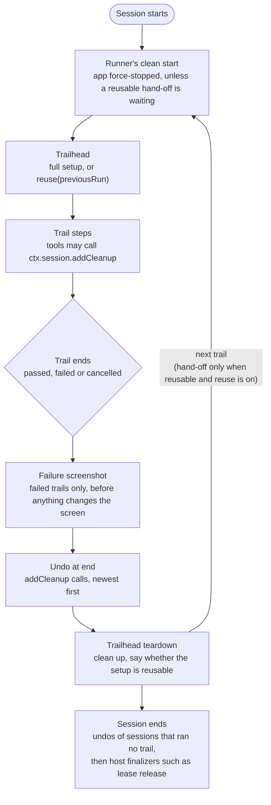

# Trail lifecycle

What runs around every trail, in what order, and which hook to use to leave a device as you
found it.

## The phases

| Phase | Runs | Use it for |
|---|---|---|
| Trailhead | at the start of each trail; skipped, in favour of `reuse`, when the last run handed on a reusable setup | reaching the trail's starting state |
| Trail steps | the trail itself | the job under test |
| Undo at end | after the last step, whatever the outcome, including a trailhead that threw | putting back a device change a tool made during the trail |
| Trailhead teardown | after the undos, whatever the outcome | cleaning up what the setup and trail left (server records, leases, uploads) and deciding reuse |
| Session end | once, when the session closes | host resources, and undos of a session that never ran a trail (MCP, interactive) |

Undo and teardown both run under a non-recordable teardown objective: each call logs as a step
in the report and never lands in a saved recording. Neither changes the trail's verdict; a failure
is logged.

## Which hook

- **A tool changes the device mid-trail** (radios, location, a fingerprint, a PIN): read the
  current state, add the undo with `ctx.session.addCleanup`, then make the change. Adding it first
  means a tool that fails halfway is still put back. See
  [Undoing a device change](scripted-tools-typed-authoring.md#undoing-a-device-change-via-ctxsessionaddcleanup).
- **The trailhead's own setup changes something its trails rely on**: undo it in the trailhead's
  [`teardown`](trailmaps.md#trailhead-teardown), not with `addCleanup`. The undo would run at the
  end of the first trail, and a reused trailhead skips setup, so later trails would start without
  the change.
- **Cleanup that can't wait** (records on a server, leases): `teardown`, which runs even when no
  trail follows. Work a full setup also redoes (back to home, clear a cart) can wait for the next
  trailhead via the hand-off's `state`.

## Order, and why

1. **The failure screenshot comes first**, so the report shows the failure as the trail left it,
   not after an undo or teardown changed the screen.
2. **Undos run before teardown.** The trailhead set up first, so it cleans up last. Teardown and
   its reuse decision see the restored device, so a teardown that needs the network gets it back
   before it runs.
3. **Session end runs last.** Undos still pending (a session that ran no trail) run before host
   finalizers release leases. On an interactive session's end the drivers may already be
   released, so only driver-free (adb) undos work there.

## What's guaranteed, and what isn't

- **Runs** on pass, fail and cancel, and when the trailhead itself throws: the runner finishes the
  trail in a `finally`.
- **Each undo gets 20 seconds**, then is cancelled and the next runs. One still running 5 seconds
  after it was cancelled is stuck where cancellation can't reach it (adb gone), so the remaining
  undos are logged as not run rather than started beside it. Teardown still runs.
- **A call added more than once runs once**, in one list or across several, at the last point it
  would have run, so the original state is still restored last.
- **Secrets stay masked.** A `rememberSensitive` value in an undo's arguments is stored as its
  `{{token}}` and resolved when the undo runs, so its log masks it like any other step's.
- **Not covered:** a killed process (undos live in memory), and a change made before its
  `addCleanup` call when the tool fails in between.

## Related

- [Trailhead teardown and reuse](trailmaps.md#trailhead-teardown): `teardown`, `ctx.previousRun`
  and `reuse`.
- [`TRAILBLAZE_TRAILHEAD_REUSE`](configuration.md): turning reuse on for a lane.
- [Reading what ran via `ctx.history`](scripted-tools-typed-authoring.md#reading-what-ran-via-ctxhistory):
  the `trailhead`, `trail` and `teardown` sections.
